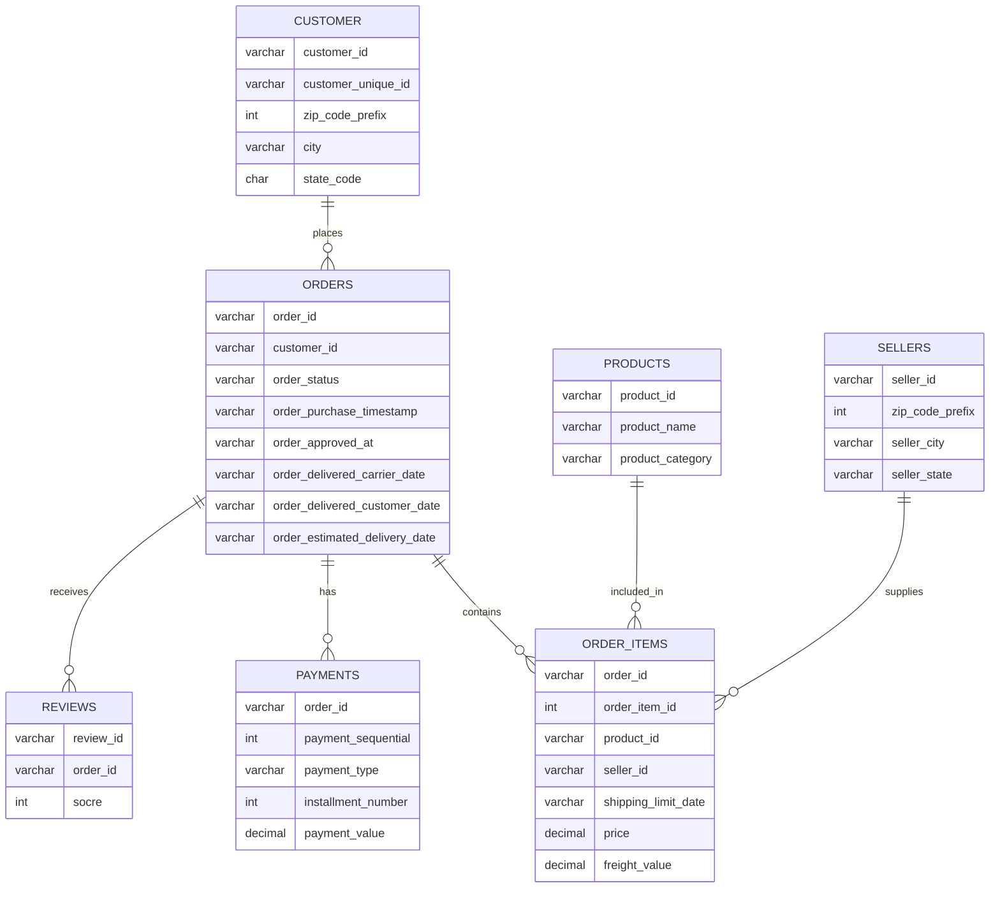

# Olist Brazilian E-Commerce — Complete ER / Data-Flow Diagram

This diagram reflects the uploaded `schema&load_data.sql` script. It includes the seven final business tables and the two staging tables used during data preparation.

> **Schema accuracy note:** The script does not declare `PRIMARY KEY` or `FOREIGN KEY` constraints. The solid relationships below are logical joins inferred from matching columns, not database-enforced constraints. The script first creates a table named `orders` for line items, renames it to `order_items`, and then creates the order-header `orders` table.

## Staging data flow

- `product_draft` → `products`: the script loads the source product CSV into `product_draft`, then inserts the selected product columns into `products`.
- `reviews_draft` → `reviews`: the script loads and cleans review data in `reviews_draft`, then inserts `review_id`, `order_id`, and `socre` into `reviews`.

`product_draft` and `reviews_draft` are staging tables, not additional business entities in the final analytical model.

## Table roles

| Table | Role |
|---|---|
| `customer` | Customer attributes and location |
| `orders` | One order-header record per order (intended grain) |
| `order_items` | Product/seller line items, price and freight |
| `products` | Product attributes and category |
| `sellers` | Seller attributes and location |
| `payments` | Payment records; multiple sequences can belong to one order |
| `reviews` | Selected review identifiers, order IDs and scores |
| `product_draft` | Product import and cleaning stage |
| `reviews_draft` | Review import and cleaning stage |

## Important modeling notes

- `customer_id` links `customer` to `orders`; `customer_unique_id` represents the underlying person across order-level customer IDs.
- `order_items` is the line-item table and joins to `orders`, `products`, and `sellers`.
- `payments` and `reviews` join to `orders` using `order_id`.
- The uploaded script does not declare primary keys or foreign keys. Validate uniqueness and orphan records before adding constraints.
- Column spellings such as `product_catagory` and `socre` are preserved from the uploaded script.
